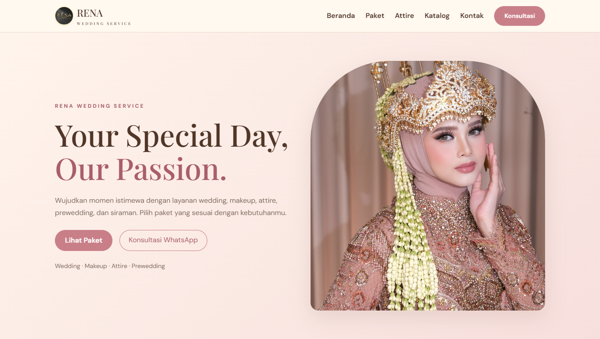
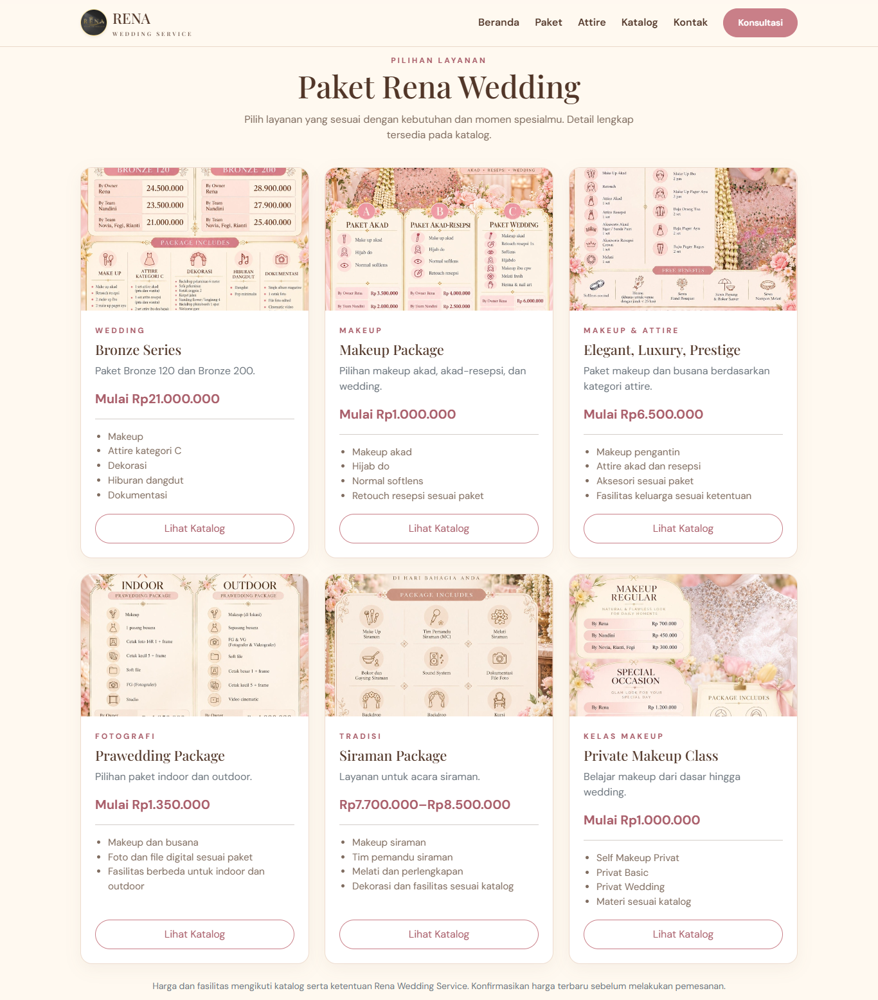
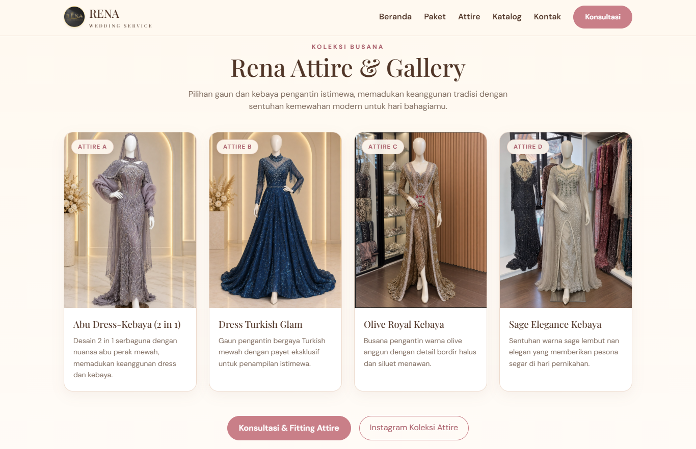
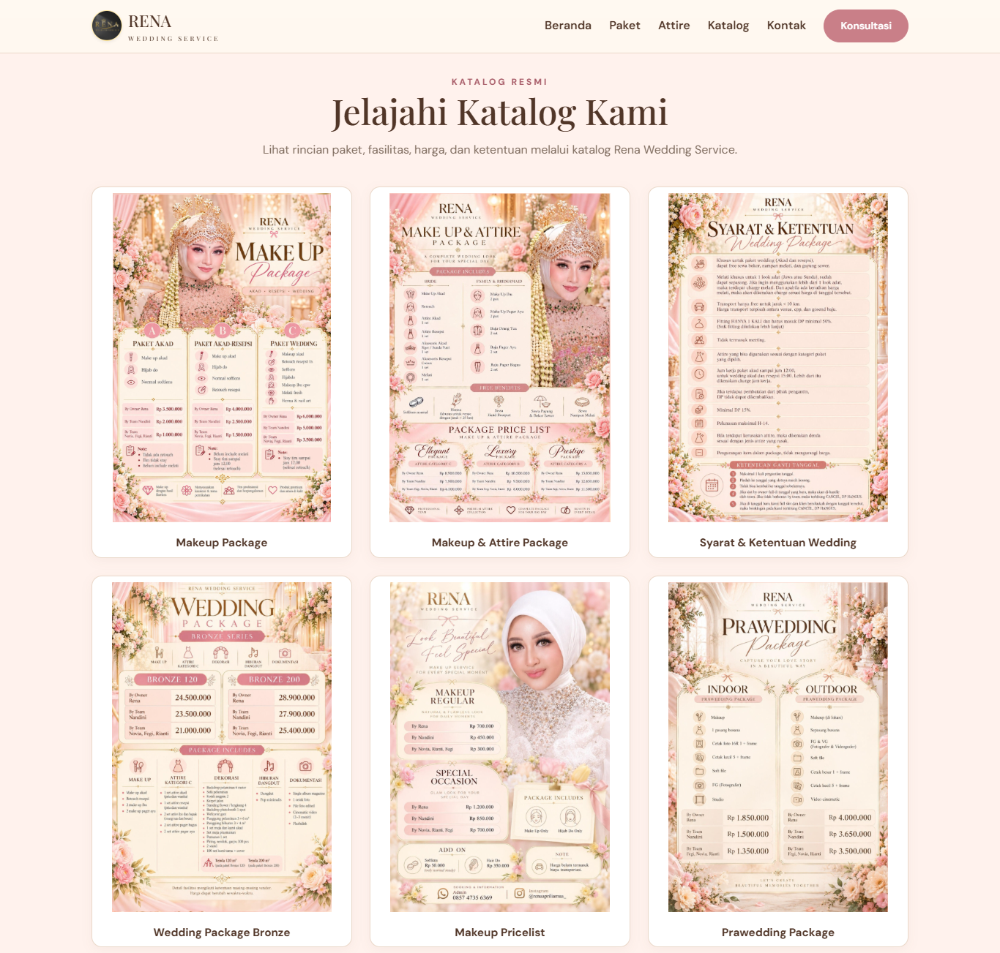
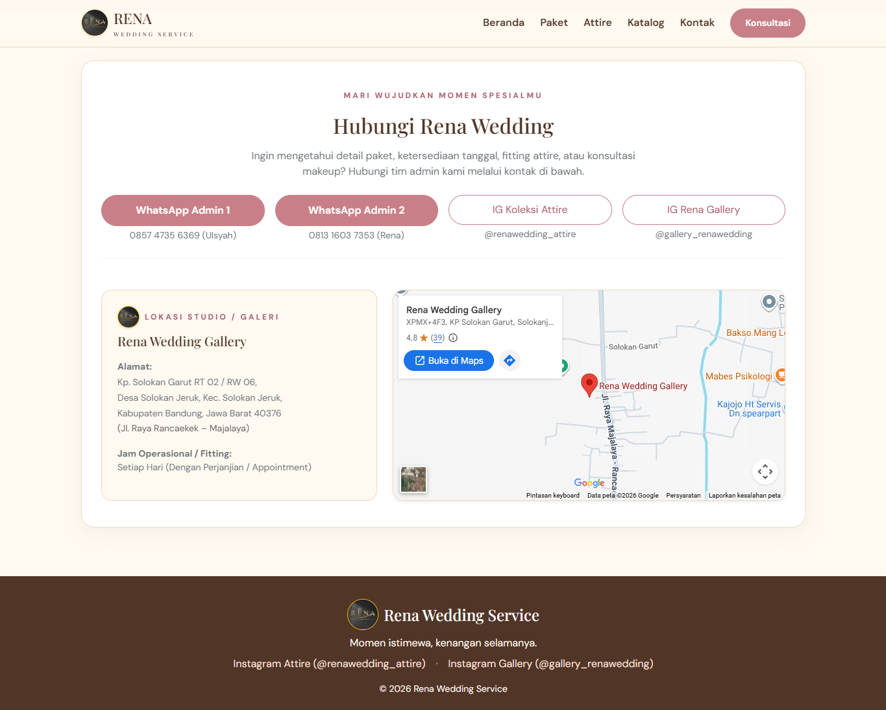

# Rena Wedding Service

**A Modern Wedding Service Landing Page**

Rena Wedding Service adalah website landing page untuk memperkenalkan layanan pernikahan, makeup, busana pengantin, dan berbagai paket wedding. Website ini dirancang dengan tampilan elegan, modern, dan responsif untuk membantu calon pelanggan mendapatkan informasi layanan dengan mudah.

## 📸 Website Preview

### 1. Homepage
Halaman utama yang menampilkan identitas brand, layanan unggulan, dan navigasi website.



### 2. Layanan Wedding
Menampilkan berbagai pilihan layanan dan paket yang tersedia.



### 3. Attire & Gallery
Galeri koleksi busana pengantin untuk membantu pelanggan melihat pilihan attire.



### 4. Katalog
Halaman katalog yang menampilkan informasi paket, makeup, wedding, dan layanan lainnya.



### 5. Kontak
Halaman informasi kontak, media sosial, dan lokasi Rena Wedding Service.



---

## ✨ Features

- **Responsive Design** — Tampilan menyesuaikan ukuran layar perangkat.
- **Homepage** — Informasi utama dan pengenalan layanan.
- **Wedding Packages** — Informasi pilihan paket pernikahan.
- **Attire Gallery** — Galeri koleksi busana pengantin.
- **Service Catalog** — Katalog paket dan layanan wedding.
- **Contact Information** — Informasi kontak dan lokasi usaha.
- **Social Media Integration** — Akses ke media sosial bisnis.
- **WhatsApp Consultation** — Memudahkan calon pelanggan menghubungi admin.
- **Google Maps Integration** — Menampilkan lokasi galeri wedding.

## 🛠️ Tech Stack

- PHP
- Laravel 10
- Blade Template Engine
- HTML5
- CSS3
- JavaScript
- Vite

*Sesuaikan daftar teknologi di atas dengan teknologi yang benar-benar digunakan dalam project.*


## 🚀 Installation

### Prerequisites

Pastikan perangkat sudah memiliki:
- PHP yang kompatibel dengan Laravel 10.
- Composer.
- Node.js dan npm jika diperlukan untuk membangun aset frontend.

### Setup Project

**1. Clone repository**

```bash
git clone URL_REPOSITORY
```

**2. Masuk ke direktori project**

```bash
cd rena-wedding
```

**3. Install dependency PHP**

```bash
composer install
```

**4. Buat file environment**

Salin `.env.example` menjadi `.env`, kemudian sesuaikan konfigurasi aplikasi.

**5. Generate application key**

```bash
php artisan key:generate
```

**6. Install dependency frontend jika diperlukan**

```bash
npm install
```

**7. Build aset frontend**

```bash
npm run build
```

**8. Jalankan aplikasi**

```bash
php artisan serve
```

Buka alamat lokal yang ditampilkan di terminal untuk melihat website.

> Catatan: Sesuaikan langkah instalasi dengan konfigurasi project. Jika website tidak memerlukan database, konfigurasi database dan migrasi tidak perlu ditambahkan.

## 🎯 Project Purpose

Project ini dibuat sebagai implementasi pengembangan website landing page untuk bisnis wedding service, dengan fokus pada penyajian informasi layanan, katalog, galeri, dan kemudahan komunikasi dengan calon pelanggan.

## 👨‍💻 Developer

**Hendra Purnama**

Information Systems Student | Web Developer


--

<p align="center">
  Designed and developed with care for Rena Wedding Service.
</p>